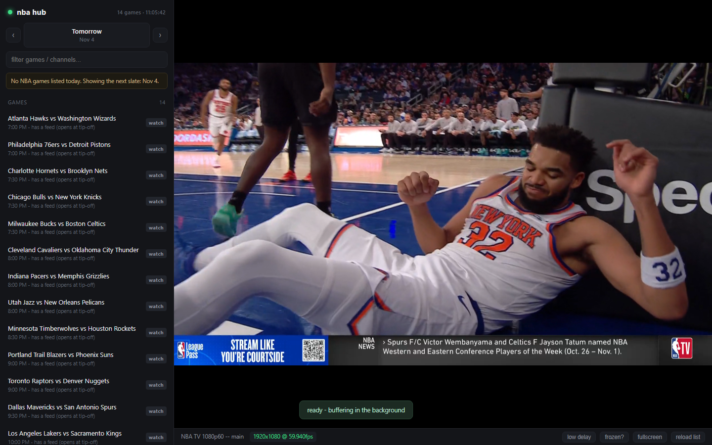
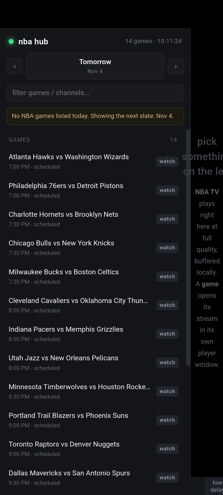
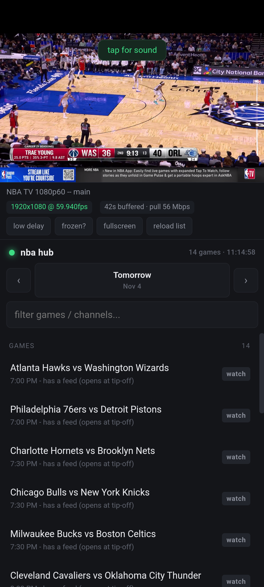
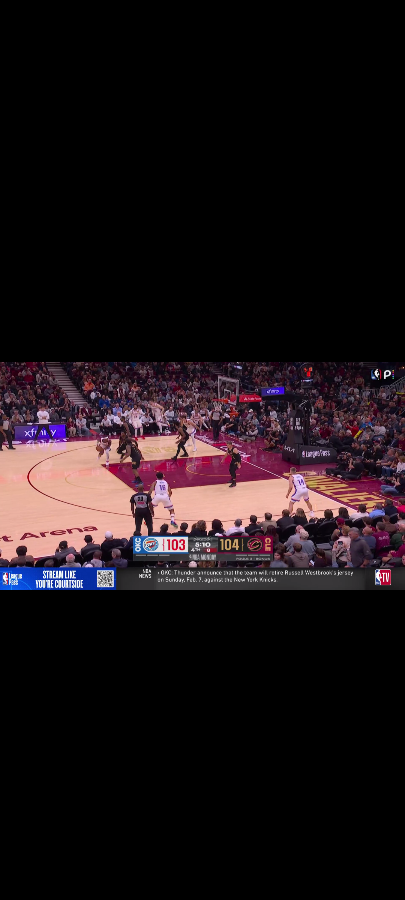

# NBADS — NBA stream hub + Android shell

A local hub that lists tonight's NBA games from the real schedule, finds a stream for the one
you click, and plays it with the highest quality the source offers — buffered locally so it
cannot stutter, and wrapped so you never see the host site's nav bar, chat column or ads.

Two pieces:

| Piece | Runs on | What it does |
|---|---|---|
| `nba/` + `pc/` | Windows PC (Python 3.11+) | schedule sync, feed probing, HLS relay, browser UI, 20 KB `.exe` launcher |
| `android/` | any Android 7+ phone | 20 KB WebView shell: finds the hub on the wifi, plays NBA TV in-app, hands games to the browser |

The desktop does the work; the phone is a remote screen for it. Fixes ship to the phone
without rebuilding the APK.

---

## Quick start (PC) — the app

```
nba\hub\NBAHub.exe
```

Double-click it. It starts the hub if it is not already running, waits until it answers, and
opens a **chromeless chromium window** (Chrome or Edge, `--app`, private profile) showing the
list. That window *is* the app: no tabs, no address bar, its own icon in the taskbar.

### Is the exe standalone? No — and here is the honest dependency list

`NBAHub.exe` is 23 KB. It is a **launcher**, not the app. It needs, in the same tree:

| Needs | Why | Size |
|---|---|---|
| `hub.py`, `index.html`, `hls.min.js`, `probe_play.py`, `find_stream.py` in `nba\hub\` | the server and the page | ~0.5 MB |
| `relay.py`, `feeds.txt` in `nba\` | the buffering relay and the channel list | ~20 KB |
| **Python 3.11+** on PATH | runs the server and the relay | 23 MB |
| **`requests` + `urllib3`** in that Python | `relay.py` pulls the stream with them | 3 MB |
| **Chrome / Chromium / Firefox / Brave** | the app window is that browser in `--app` mode | already on the PC |
| **.NET Framework 4.x** | what `NBAHub.exe` itself is compiled against | built into Win10/11 |
| *optional:* `playwright` + its chromium | game probing only (`/api/resolve`); without it channels are unaffected and games still open in the browser | ~200 MB |

### The portable bundle — no Python needed on the target PC

`releases/NBAHub-portable.zip` (**11.8 MB**, 23.7 MB extracted) contains its own interpreter:

```text
START.bat                  double-click this
README-PORTABLE.txt        what is inside, what it needs, troubleshooting
python\                    Python 3.13.7 embeddable + requests/urllib3 (23 MB)
nba\hub\NBAHub.exe         the launcher (23 KB)
nba\hub\hub.py …           server, page, hls.min.js, probes
nba\relay.py, feeds.txt    relay + channel list
```

The launcher looks for `..\..\python\pythonw.exe` first (`using the bundled interpreter` in
`launcher.log`), so a PC with no Python at all runs it. What it still wants: a browser and
.NET 4.x — both effectively part of Windows. Playwright is not bundled; add it with
`python\python.exe -m pip install playwright` if you care about probing game pages.

Unzip somewhere writable (Desktop, Documents — **not** Program Files: the window profile is
written next to the exe).

**Close the window and everything stops** — the relays and the Python server are shut down via
a loopback-only `/api/shutdown`. Nothing is left running in the background.

```text
NBAHub.exe                0.0.0.0:8790 (phone can still connect), app window
NBAHub.exe --local        bind 127.0.0.1 only
NBAHub.exe --port 8791    another port
NBAHub.exe --size 1920x1080
NBAHub.exe --dir PATH     where hub.py lives (default: next to the exe)
```

Details worth knowing:

- **Which browser.** Chrome first, Firefox second, Brave, and **Edge only if it is the last
  chromium installed** — Edge is the Windows default, and it kept opening when something asked
  for "the browser". The launcher logs its choice:
  `browser=chrome exe=C:\Program Files\Google\Chrome\Application\chrome.exe`.
  Force another one either way:
  - `NBAHub.exe --browser firefox`
  - or drop a `browser.txt` next to `NBAHub.exe` holding `chrome`, `firefox`, `edge`, `brave`
    or a full path to an `.exe`
  Chrome/Brave/Edge get a chromeless `--app` window; Firefox gets its own profile and instance
  (`-no-remote -new-instance -profile appprofile -new-window …`) because it has no app mode.
  `/api/ping` reports the choice (`"browser":"chrome"`), and games opened from the PC go
  through the same function.
- **On the phone** the game hand-off is pinned to Chrome (`com.android.chrome`), then Firefox
  (`org.mozilla.firefox`), then a chooser — it no longer follows the system default (which is
  Edge on many phones). That needed a `<queries>` block in the manifest: Android 11+ hides
  installed packages, so `getLaunchIntentForPackage("com.android.chrome")` silently returned
  null without it.
- If a hub is **already running** (started by `NBAHUB.bat`, or a second double-click) the app
  reuses it, opens another window, and does **not** stop it on close — the owner keeps owning.
- Log of every decision: `%LOCALAPPDATA%\NBAHubPC\launcher.log`.
- Build/rebuild it: `powershell -ExecutionPolicy Bypass -File pc\build-pc.ps1` (uses the .NET
  Framework compiler that ships with Windows — no Visual Studio, no NuGet).
- No Chrome, Firefox or Edge installed? It falls back to your default browser plus a small
  window that keeps the server alive until you close it.

`NBAHUB.bat` still works and now just hands over to `NBAHub.exe` when it is present.

## What the page does (same in the app window or a browser)

- **Games** — click a row marked `live`. The feed is probed first; the player opens in a
  sandboxed 16:9 shell, ad-free and popup-proof.
- **NBA TV** — always-on channels. These play *inside* the page through the local relay:
  1080p60, ~60 s buffered, 60–200 Mbps pull.
- **latency** — the bar shows `14.2s behind live` (straight from hls.js). Measured on this PC:
  **~0.4–1.2 s from click to first frame**, 14.6 s behind live by default, **8.2 s with
  `low delay`**, zero stalls in a 60 s sample. The relay fetches ahead of the player over 6
  parallel keep-alive sockets, so the picture reads from localhost.
- **fullscreen** — the picture is letterboxed to the stream's own ratio, never stretched:
  measured 1680x945 on a 16:10 1680x1050 screen (16:9 stream), and 1080x609 on a 1080x2400
  phone. `✕ exit full` sits in the corner, Esc works too.
- Keys on the PC: `f` fullscreen, `m` mute, `r` reload the feed (plus Esc to leave fullscreen).
- `frozen?` — one tap logs a freeze so the switching policy can act; a cross-origin frame
  cannot be watched by code.
- `reload stream` — reconnect the same feed without losing state.
- **long-press the `nba hub` title** — diagnostics: secure context, hls.js, Widevine/EME,
  relay state, video readyState. This is the first thing to look at when a stream is black.

CLI equivalents live in `nba/`: `NBA.bat` (channel in VLC), `GAMES.bat` (game list),
`CHECK.bat` (resolution + throughput per feed), `REFRESH.bat` (re-harvest).

Plain browser, no exe: `cd nba\hub; .\NBAHUB.bat` starts the server and opens a Chrome app
window; or open `http://127.0.0.1:8790/` yourself.

## Quick start (Android)

Install `releases/NBAHub.apk`, open it, and keep `NBAHUB.bat` running on the PC on the same
wifi. The app now **finds the PC itself** (scans the /24 for `:8790/api/ping`); long-press
anywhere to type an address instead, or to run `scan wifi` again.

- **NBA TV** plays in the app: the relay is reached over the wifi, not `127.0.0.1`.
- **Games** open in the phone's browser. That is not laziness: game feeds are Widevine, and
  EME is unavailable to a WebView on a `http://192.168.x.x` origin, so an in-app frame can
  only ever be a black rectangle. A browser is a secure context with a CDM.
- **fullscreen** works through the video element (`onShowCustomView`), not `requestFullscreen`.
- **Back** leaves fullscreen, then a game page, then the app — it never lands on a blank page.
- After a game hands you to the site, the `⌂` chip on the right edge brings you back.

If the phone cannot reach the PC at all, run **`nba\hub\FIREWALL.bat`** once as admin: it opens
inbound TCP `8790` (hub) and `8900-8959` (relays), which Windows blocks on a Private network.

Build it yourself:

```powershell
cd android
.\build.ps1        # aapt2 -> javac -> d8 -> zipalign -> apksigner, no Gradle
adb uninstall com.nbahub.app          # after any keystore change
adb install --no-incremental android\NBAHub.apk
adb install -r --no-incremental ...   # fails with INSTALL_FAILED_UPDATE_INCOMPATIBLE if the
                                      # debug keystore was regenerated; uninstall first
```

## Screenshots

| Desktop | Phone, before | Phone, playing | Phone, fullscreen |
|---|---|---|---|
|  |  |  |  |

## Read this before changing anything

**[SOP_NBA_Stream_Hub.md](SOP_NBA_Stream_Hub.md)** — the full procedure, including the bugs
that cost the most time:

- the stream sites stamp games with the **UTC** date, so a 7 PM Eastern tip-off is numbered
  with tomorrow's date; the schedule must come from ESPN, not from the URL
- `d8` from build-tools 34 crashes on anonymous inner classes; use 36
- `adb install` without `--no-incremental` produces phantom app deaths
- Android's WebView drops the user gesture across `await`, so autoplay must start muted
- **a relay URL of `127.0.0.1` means "this phone", not "that PC"** — the hub returns the host
  the client used, the relay binds `0.0.0.0`, and that one line was the whole "the stream does
  not play" bug (SOP §13)

## Limits, stated plainly

- **Game streams are Widevine/PlayReady DRM.** No third-party player can decode them, and an
  Android WebView cannot either (no EME on an insecure origin). Desktop: an embedded Chrome
  frame. Phone: the browser. Channels are open HLS and run in our own player.
- The aggregator HTML is the fragile dependency: if their `ItemList` block changes shape, the
  game list empties — visibly, which is the failure mode worth having.
- A pre-game page shows a countdown, not a picture. `has a feed (opens at tip-off)` in the
  list means exactly that; the probe cannot make a stream exist before tip-off.
- Software-rendered emulators die on 1080p60 decode after a few minutes (`qemu ... 0xc0000005`
  in the Application log). That is the emulator, not the app; a real device is fine.
- The PC has to stay reachable: ports `8790` and `8900-8959`. If a network is "guest /
  client-isolated", no rule helps.

## Layout

```text
nba/            hub, relay, probes, CLI launchers, feeds.txt
  hub/          server, UI, hls.min.js, probes, NBAHUB.bat, FIREWALL.bat,
                NBAHub.exe (the PC app, built by pc/build-pc.ps1)
pc/             NBAPC.cs (the launcher), build-pc.ps1, app.ico
android/        manifest, MainActivity.java, res/, build.ps1
releases/       NBAHub.apk (signed, 25 KB)
docs/           screenshots + the scripts used to verify them:
                cdp.py (drive the phone's WebView over CDP), desktop_check.py,
                stats_check.py (relay → stat pill), page_dump.py (what a stream
                page is doing right now)
```
