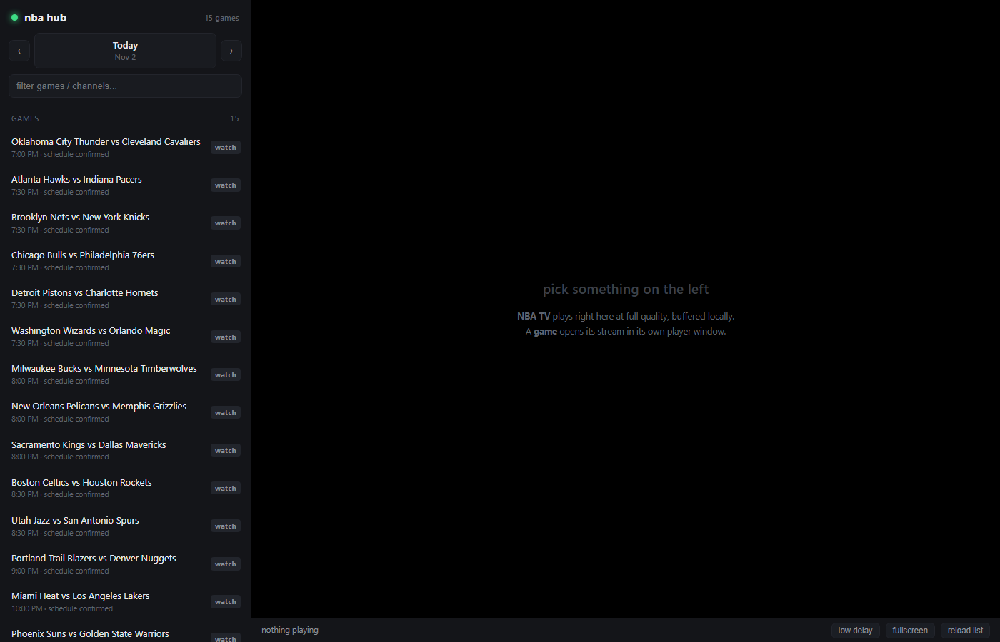
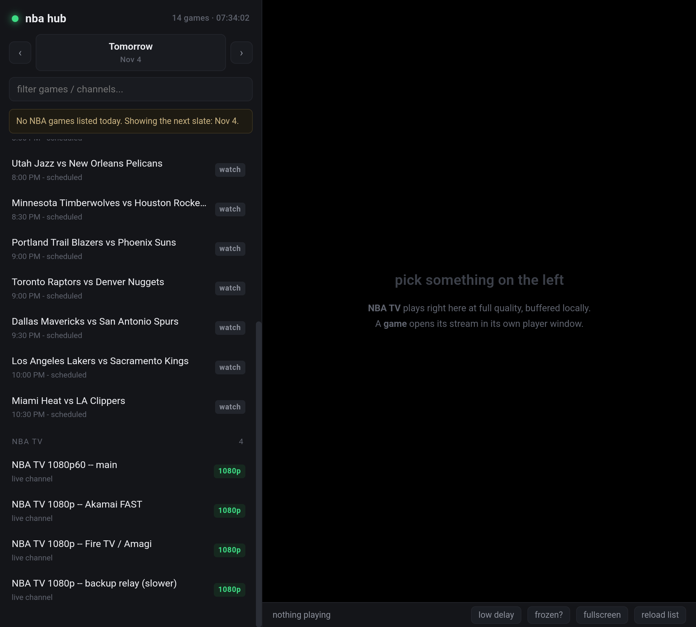

# NBADS — NBA stream hub + Android shell

A local hub that lists tonight's NBA games from the real schedule, finds a stream for the one
you click, and plays it with the highest quality the source offers — buffered locally so it
cannot stutter, and wrapped so you never see the host site's nav bar, chat column or ads.

Two pieces:

| Piece | Runs on | What it does |
|---|---|---|
| `nba/` | Windows PC (Python 3.11+) | schedule sync, feed probing, HLS relay, browser UI |
| `android/` | any Android 7+ phone | 16 KB WebView shell that opens the hub fullscreen |

The desktop does the work; the phone is a remote screen for it. Fixes ship to the phone
without rebuilding the APK.

---

## Quick start (PC)

```powershell
cd nba\hub
.\NBAHUB.bat
```

It restarts the server, opens a Chrome app window, and lists tonight's slate.

- **Games** — click a row marked `live`. The feed is probed first; the player opens in a
  sandboxed 16:9 shell, ad-free and popup-proof.
- **NBA TV** — always-on channels. These play *inside* the page through the local relay:
  1080p60, ~60 s buffered, 80–200 Mbps pull.
- `frozen?` — one tap logs a freeze so the switching policy can act; a cross-origin frame
  cannot be watched by code.
- `reload stream` — reconnect the same feed without losing state.

CLI equivalents live in `nba/`: `NBA.bat` (channel in VLC), `GAMES.bat` (game list),
`CHECK.bat` (resolution + throughput per feed), `REFRESH.bat` (re-harvest).

## Quick start (Android)

Install `releases/NBAHub.apk`, open it, and keep `NBAHUB.bat` running on the PC on the same
wifi. Default address `http://192.168.1.6:8790/`; **long-press anywhere** to change it.

Build it yourself:

```powershell
cd android
.\build.ps1        # aapt2 -> javac -> d8 -> zipalign -> apksigner, no Gradle
```

## Screenshots

| Desktop | Foldable emulator |
|---|---|
|  |  |

## Read this before changing anything

**[SOP_NBA_Stream_Hub.md](SOP_NBA_Stream_Hub.md)** — the full procedure, including the four
bugs that cost the most time:

- the stream sites stamp games with the **UTC** date, so a 7 PM Eastern tip-off is numbered
  with tomorrow's date; the schedule must come from ESPN, not from the URL
- `d8` from build-tools 34 crashes on anonymous inner classes; use 36
- `adb install` without `--no-incremental` produces phantom app deaths
- Android's WebView drops the user gesture across `await`, so autoplay must start muted

## Limits, stated plainly

- **Game streams are Widevine/PlayReady DRM.** No third-party player can decode them; an
  embedded browser frame is the ceiling. Channels are open HLS and run in our own player.
- The aggregator HTML is the fragile dependency: if their `ItemList` block changes shape, the
  game list empties — visibly, which is the failure mode worth having.
- Video decode was `UNVERIFIED` on the emulator (software codec path). If the picture is black
  on a real device, the fix is ExoPlayer/media3 instead of WebView.

## Layout

```text
nba/            hub, relay, probes, CLI launchers, feeds.txt
  hub/          server, UI, player shell, headless probes
android/        manifest, MainActivity.java, res/, build.ps1
releases/       NBAHub.apk (signed, 16 KB)
docs/           screenshots
```
