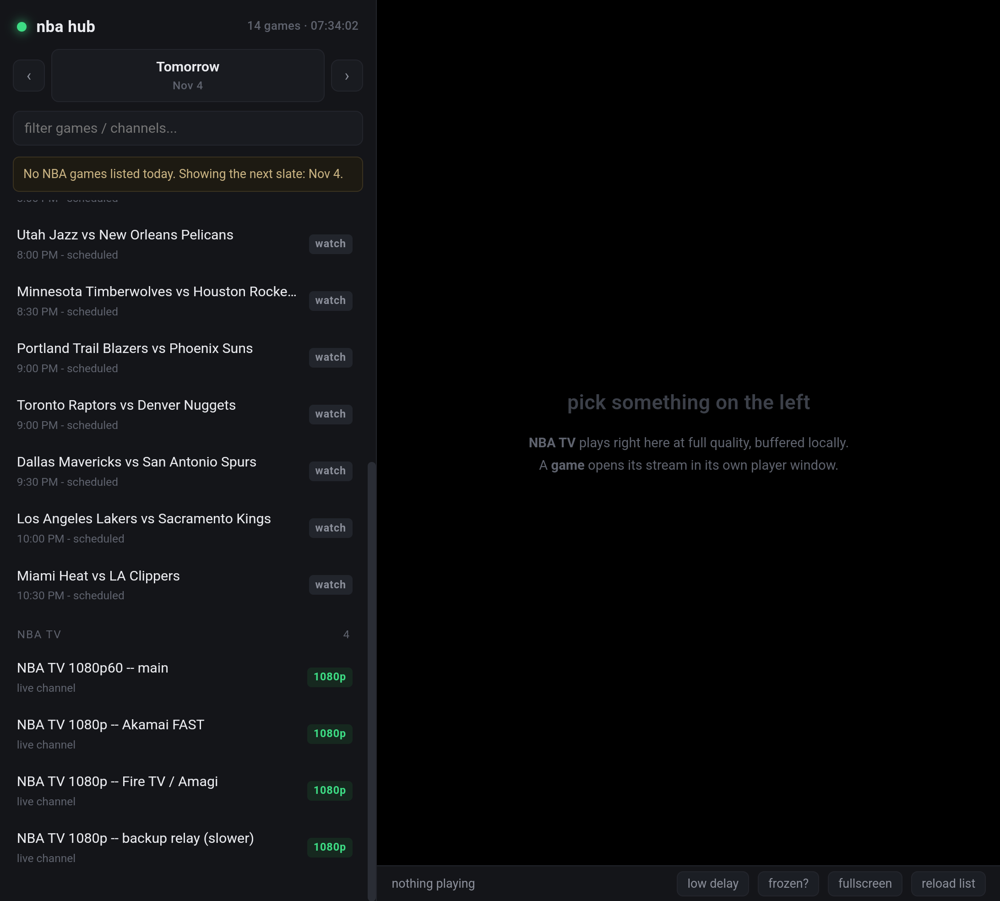
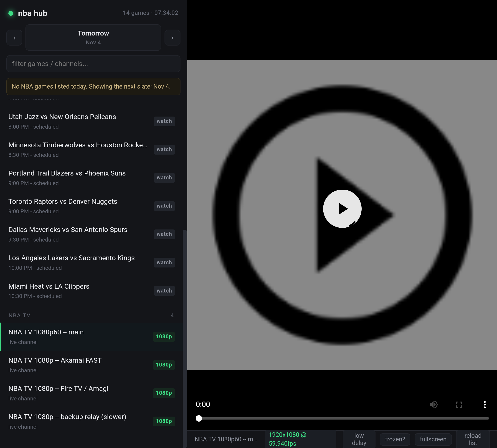

# SOP — NBA Stream Hub: schedule-synced game list, forced-quality HLS relay, and a Fold-native Android shell

Reusable procedure for building a **local, ad-free stream aggregator** that keeps a game
list in sync with the real NBA schedule, forces the highest rendition on every open HLS
stream, survives mid-game feed failures, and ships to a foldable phone as an APK — written
from a real run on **Windows 11** against the `methstreams` / `crackstreams` family of
aggregators, with the target device being a **Samsung Galaxy Z Fold 7**.

Everything here was built and verified in one session, including the failures. The parts
that could **not** be verified are marked `UNVERIFIED` rather than described as working.

Two artefacts are produced:

| Artefact | What it is |
|---|---|
| `nba/` | Python + PowerShell hub. Scrapes the schedule, probes feeds, runs a local buffering HLS relay, serves a browser UI. |
| `android/` | A 16 KB WebView shell (`com.nbahub.app`) built **without Gradle**, installable on Android 7+. |

---

## What was delivered, in order

1. **A game list that cannot lie about the date.** ESPN's scoreboard API is the source of
   truth; the aggregators only supply stream URLs. Nothing is inferred from a URL again
   (that mistake cost a full rebuild — see §3.3).
2. **Quality forcing.** The relay reads the HLS master playlist and picks the top rendition
   by `RESOLUTION` then `BANDWIDTH`. Verified: `1920x1080 @ 59.940 fps, 8.25 Mbps` on a feed
   whose first variant is 640x360.
3. **A local buffer that removes stutter.** ~10 segments held in RAM, served from
   `127.0.0.1`, prefetched over 6 parallel keep-alive sockets. Measured **80–200 Mbps** pull
   against a 6–8 Mbps stream.
4. **A page that never shows site chrome.** The real player host is extracted from inside
   the aggregator page and re-hosted in a local 16:9 sandboxed shell; popups are made
   impossible, not blocked.
5. **A switching policy with a 2-minute grace**, 15-second stall detection, ask-before-upgrade
   and a 3-freeze threshold — plus an honest account of what code cannot see (§8).
6. **A signed APK built by hand** (`aapt2` → `javac` → `d8` → `zipalign` → `apksigner`),
   fullscreen, fold-safe, with an error page instead of a black screen.
7. **Verified on a foldable emulator** at the Fold 7's inner geometry — layout, fullscreen,
   LAN fetch, manifest parse at 1080p60. Video **decode** did not start on the emulator and
   is marked `UNVERIFIED` (§10.3).

---

## 1. Prerequisites & toolkit

| Tool | Version used | Purpose |
|---|---|---|
| Python | 3.13.15 | hub, relay, probes (`requests` 2.34.2) |
| Node | 18+ | not required by the app; only used incidentally |
| ffmpeg / ffprobe | 9.0.2 (winget `Gyan.FFmpeg`) | one-off stream validation, icon generation |
| Playwright (Python) | chromium 156.0.8078.4 | headless probes: does this page *play*? |
| JDK | 21.0.12.1 (Microsoft) | `javac`, `keytool` |
| Android SDK build-tools | **36.0.0** | `aapt2`, `d8`, `zipalign`, `apksigner` |
| Android platform | `platforms/android-35/android.jar` | compile-time API |
| platform-tools | 37.0.1 | `adb` |
| Emulator AVD | API 34, `google_apis`, `x86_64`, device profile **8in Foldable** | install-and-screenshot loop |
| `gh` CLI | authenticated as the repo owner | `gh repo clone`, push |

Machine-specific setup that costs time if missed:

- SDK lives at **`C:\Android\Sdk`**, not under `%LOCALAPPDATA%`.
- **`build-tools\34.0.0`'s `d8` crashes on any anonymous inner class** compiled by javac 21
  (`NullPointerException: Cannot invoke "String.length()" because "<parameter1>" is null`,
  origin `Foo$1.class`). `build-tools\36.0.0` handles the same classes. Use 36.
- PowerShell 5.1: native tools writing to **stderr** become terminating errors when
  `$ErrorActionPreference='Stop'`. `keytool -genkeypair` prints progress to stderr and will
  abort the build after it has already created the keystore. Use `'Continue'` + explicit
  `$LASTEXITCODE` checks, or `*> $null`.
- **`adb install` streams incrementally by default** on API 30+. The APK is served from the
  host; when that session drops, the package is torn down and the running app dies with
  `Got obituary of <pid>`. Symptom: the app vanishes after a few taps, with no crash in
  logcat. Always `adb install --no-incremental` when testing.
- The workspace path contains a space (`C:\AI STUFF\…`); quote every path passed to
  `Start-Process`, `jar`, `d8`, `javac`.

---

## 2. What the sources actually are (recon before writing any code)

### 2.1 The three independent data flows

| Need | Source | Shape | Keyless? |
|---|---|---|---|
| Which games, what time, are they final | `site.api.espn.com/apis/site/v2/sports/basketball/nba/scoreboard?dates=YYYYMMDD` | JSON, `events[].competitions[0].competitors[]` | yes |
| Stream page per game | `https://methstreams.st/nba`, `https://crackstreams.st/nba` | HTML containing a `schema.org ItemList` block | yes |
| The actual video | pushed from inside the player iframe | HLS `.m3u8` | yes, but DRM (see §2.4) |

### 2.2 The aggregator list is machine-readable — don't scrape the DOM

Each NBA page embeds one `<script type="application/ld+json">` block:

```json
{"@type":"ListItem","position":1,
 "name":"Oklahoma City Thunder vs Cleveland Cavaliers",
 "url":"https://methstreams.st/event/m-oklahoma-city-thunder-vs-cleveland-cavaliers-1103"}
```

Sixteen entries, stable, no browser needed. Parsing the rendered page instead is a dead end:
those pages are JavaScript apps and the raw HTML contains **no** `.m3u8` and **no** `<iframe>`.

### 2.3 The UTC date trap — the bug that produced "no games today"

The URL suffix (`-1103`) is the **UTC** date. A 7:00 PM Eastern tip-off is already past
midnight UTC, so tonight's games are stamped with *tomorrow's* number. Reading that suffix as
the local game date files the entire slate one day forward and leaves "today" empty — which
is exactly what happened here, and what made the first build look broken while 15 games were
sitting in the list.

```text
ESPN says:   Nov 2 slate = 15 games, first tip 2026-11-03T00:00Z   <- game night = Nov 2
Aggregator:  every one of those games is suffixed -1103            <- UTC date
```

**Rule that came out of this:** a date is not a fact to be inferred from a URL. Join the
stream to an authoritative schedule by **team name** and take the date and time from the
schedule. Never guess.

### 2.4 The video is DRM'd — this decides the whole architecture

Following one game page to its actual stream:

```text
methstreams /event/m-toronto-raptors-vs-la-clippers-1103
  -> "Main 1" link  ->  foxiy.st/event/.../main/1
  -> <iframe>       ->  topstreamer.site/iframe/nba/clippers
  -> network        ->  lpnba.akamaized.net/live-pz/p/hls-wvpr/g0022600171tor1000460lac/index.m3u8
```

The master playlist carries:

```text
#EXT-X-SESSION-KEY:METHOD=SAMPLE-AES-CTR,KEYFORMAT="urn:uuid:edef8ba9-…"   <- Widevine
#EXT-X-SESSION-KEY:METHOD=SAMPLE-AES-CTR,KEYFORMAT="urn:uuid:9a04f079-…"   <- PlayReady
```

`ffprobe`, VLC and hls.js all fail on it. Only a browser with a CDM can decrypt. Consequence,
and it governs everything after this point:

- **Channels** (open HLS, no DRM) → can play in our own player, buffered by our relay.
- **Games** (Widevine) → can only play inside a browser engine. Our job becomes: pick the
  right page, present it cleanly, and know when it has gone bad.

Extracting the raw URL is still useful — it takes ~2 s with a headless browser and gives the
health signal in §8 — but it is not playable outside a browser.

---

## 3. Architecture

```text
nba/
  feeds.txt            permanent channel list      NAME | URL
  live.txt             written by refresh.ps1, read first
  sites.txt            pages the scraper may try
  relay.py             local HLS relay: rendition pick + buffer + stats
  sniff.py             headless-browser stream hunter (experimental)
  play.ps1             CLI launcher (channels)
  games.ps1            CLI game list
  refresh.ps1          harvest + probe, rewrites live.txt
  hub/
    hub.py             HTTP server: games API, resolve API, shell, proxies
    index.html         the UI (single file, hls.js)
    probe_play.py      "does this page actually play?" (all frames)
    find_stream.py     "what is the real playlist behind this page?"
    clean/             MV3 extension (see §7.4 — does not load on modern Chrome)
    NBAHUB.bat         launcher: restart server, open app window
android/               WebView shell, built without Gradle
```

The hub is deliberately **stdlib-only** apart from `requests`: one file to read, no
dependency resolution, no build step, starts in under a second.

### 3.1 Endpoints

| Route | Does |
|---|---|
| `/api/games?date=YYYY-MM-DD` | games for that night, joined to ESPN, with `state` (`in`/`post`), tip time, stream URL, and source health |
| `/api/dates` | every date in the ESPN window that has games |
| `/api/channels` | parsed `feeds.txt` |
| `/api/play?u=<feed>` | starts/keeps a relay, returns `http://127.0.0.1:PORT/live.m3u8` |
| `/api/resolve?u=<event>` | probes the game's feeds until one plays, returns the **player-host iframe URL** |
| `/api/watch?u=<event>` | same, then opens a clean app window (desktop path) |
| `/api/health?u=<event>` | upstream playlist advancing? (§8) |
| `/api/freeze?u=<event>` | records a user-reported freeze |
| `/api/candidates?u=<event>` | every feed for that game with resolution, best first |
| `/watch?u=<iframe>` | 16:9 sandboxed shell around the player (§7) |

Every response is sent with `Cache-Control: no-store` and the page appends `?_=<ts>`. Without
that, a browser will happily serve yesterday's "0 games" from cache and the fix looks broken.

---

## 4. The relay (`relay.py`) — quality and stutter

Two separate problems, one process.

### 4.1 Force the best rendition

A master playlist can list several renditions; the CDN decides which one a player gets, and
many players start low. The relay parses the master itself and keeps only the best:

```python
variants.sort(key=lambda v: (v["h"], v["bw"]), reverse=True)
self.url = variants[0]["url"]
```

Verified on a feed whose first-listed variant is 640x360:

```json
{"url": ".../tracks-v1a1/mono.m3u8", "w": 1920, "h": 1080,
 "bw_mbps": 8.25, "fps": "59.940", "seg_MB": 4.92, "fetch_Mbps": 74.17}
```

### 4.2 Buffer ahead so a slow segment cannot freeze the picture

The upstream hands out segments on its own schedule; one slow segment stalls the player
because it has nothing else to show. The relay keeps a rolling window fully downloaded and
publishes a segment only once it is complete in RAM.

```python
# window/2 pacing, parallel fetch, retry with backoff, skip rather than stall
for seq in missing:
    futures = {pool.submit(grab, s): s}
...
while len(self.segs) > self.window:
    old, _ = self.segs.popitem(last=False)
```

Measured on the main channel:

| Metric | Value |
|---|---|
| Window | 10–12 segments (~60–85 s of video) |
| Upstream pull | **65–206 Mbps** on a 6–8 Mbps stream |
| Local read speed | ~2,600 Mbps (RAM) |
| Segments served 404 | 0 |

The player never touches the internet; it reads localhost. Bad segments are retried and then
skipped, so the picture degrades by one segment instead of freezing.

### 4.3 Keep-alive matters

`urllib` opens a new socket per request. For 6-second segments that is measurable waste, so
the relay uses `requests.Session` with a pooled adapter (`pool_maxsize=24`), which is what
turns "parallel prefetch" into aggregate throughput rather than connection churn.

---

## 5. The game list: joining streams to a schedule

```python
rows = schedule_window()            # ESPN, day-2 .. day+3
for g in scraped:                   # aggregator JSON-LD
    away, home = slug_match(g["url"])        # "oklahoma-city-thunder" ...
    hit = match_espn(away, home, rows)       # last word of displayName in slug
    if hit:
        g["date"], g["time"] = hit["date"], local_time(hit["start_utc"])
        g["state"] = hit["state"]            # in / post
```

Two deliberate properties:

1. **A scheduled game with no stream still appears**, greyed, badge `none`. The list is a
   mirror of the schedule, so it cannot silently shrink.
2. **Finished games are marked `final` and refuse to open.** Before this, clicking a 7 PM game
   at 11 PM produced a spinner and a dead player, which reads as a bug.

Sorting is by `start_utc`, not by the formatted time string — `10:00 PM` sorts before
`7:00 PM` alphabetically, which put the last game first.

---

## 6. Quality probing without downloading the stream

`probe_play.py` answers one question: **is this page actually showing moving video right
now?** It matters because a feed page can load, look fine, and show a black box.

The naive check does not work:

```js
document.querySelectorAll('video')   // 0 elements on the event page
```

The player lives in a nested frame (`topstreamer.site/iframe/nba/clippers`), so the probe
walks **every frame**:

```python
for f in page.frames:
    st = f.evaluate(JS_STATE)        # readyState >= 2 and currentTime > 0.3
```

A good feed answers in **2–3 seconds**; a dead one is abandoned at the timeout. The probe also
returns the winning frame's URL, which is the anchor for §7.

### 6.1 Three probe traps

| Trap | Symptom | Fix |
|---|---|---|
| Only the top document is checked | `video: none` on a page that is playing | iterate `page.frames` |
| Bundled Chromium has no H.264 | `readyState` never reaches 2 | probe headless is fine for *presence*; judge decode on a real browser |
| Site-side refusal text | page shows "not available here" | match the refusal string and fail fast |

---

## 7. Showing a player you do not own

### 7.1 The site forbids embedding

```text
x-frame-options: SAMEORIGIN
content-security-policy: frame-ancestors 'self'
```

A browser enforces this; no script can opt out. But the **player host** inside it is a
different origin, and it does not set those headers:

```text
topstreamer.site/iframe/nba/clippers     ->  200, no XFO, no CSP frame-ancestors
```

So: extract that URL from the page, embed *that*, and the aggregate site — with its nav bar,
chat column and "CLEAR CACHE · TRY A VPN" banner — is never loaded at all.

### 7.2 Re-hosting the page itself fails, and why it is worth knowing

Proxying the aggregate page through the hub (strip XFO, inject `<base>`, patch `fetch`/XHR)
renders a page that says:

> **This stream is not available here.** It plays only on the sites it was made for.

The player checks its own origin. Do not spend time on this; go to §7.1 instead.

### 7.3 A shell that is only the video

`hub.py` serves `/watch?u=<iframe>`:

```html
<iframe src="…" allow="autoplay; fullscreen; encrypted-media"
        sandbox="allow-scripts allow-same-origin allow-forms allow-presentation"
        allowfullscreen></iframe>
```

- `width:min(100%, 100vh*16/9)` — letterboxed, so the player's white page background never
  shows as a strip under the video.
- **`allow-popups` is deliberately absent.** The ad windows are a `window.open()` in a click
  handler; without that flag the browser drops the call before any request leaves. Measured:
  6 clicks on the player, 1 blocked attempt, 0 windows, video still running.
- The ad opened in **Edge** on the test machine because popups are handed to the *default*
  browser — which is why "it has no adblocker" was true and irrelevant. Kill the popup, not
  the browser.
- A `reload stream` button re-points the iframe with a cache-buster, so a frozen feed is one
  click from recovery without losing the app state.

### 7.4 The extension that did not work

An MV3 content-script extension was written to hide nav/chat and override `window.open`.
**Chrome 137+ ignores `--load-extension` from the command line**; `--disable-features=
DisableLoadExtensionCommandLineSwitch` no longer restores it. Verified both on bundled
Chromium and on real Chrome: content script never ran (`window.__nbaClean === false`).

`clean/` is kept in the repo as a working reference for a manually-installed extension, but
the app does not depend on it. The sandbox does the popup work instead — correctly, and
without an install step.

---

## 8. The switching policy

Requested behaviour, implemented verbatim:

| Rule | Implementation |
|---|---|
| Let it play 2 minutes before judging | `Date.now() - pol.start < 120000 → hold` |
| Only switch when it is lagging | server-side stall detection, polled every 10 s |
| If it stops lagging, wait for 3 freezes | freeze counter persists; lag clears → no action |
| Better quality than what is playing → ask first | `window.confirm()` with `better.h` vs `pol.curH` |
| Worst quality + lagging → just switch | falls back to any working candidate after 3 freezes |

Lag is measured from the **upstream playlist**, not the picture:

```python
seq, _ = playlist_state(url)
if seq != h["seq"]:
    h["seq"], h["since"] = seq, now
h["lagging"] = (now - h["since"]) > 15
```

### 8.1 The honest limit

A freeze **inside** the player frame cannot be sensed by any code we run — the frame is
cross-origin and sealed. Two signals exist, and only two:

1. **Upstream stall** — automatic, from the playlist (§8).
2. **User report** — one tap on `frozen?`, which increments the counter the policy reads.

Anything else would be guessing. Saying so is more useful than shipping a watchdog that
notices nothing.

---

## 9. The Android app, built without Gradle

Gradle is not installed and does not need to be. Five tools produce a signed APK:

```powershell
$bt  = 'C:\Android\Sdk\build-tools\36.0.0'
$jar = 'C:\Android\Sdk\platforms\android-35\android.jar'

& "$bt\aapt2.exe" compile --dir res -o build\res.zip
& "$bt\aapt2.exe" link -o build\base.apk -I $jar --manifest AndroidManifest.xml `
    -R build\res.zip --java build\gen --auto-add-overlay `
    --min-sdk-version 24 --target-sdk-version 34 --version-code 1 --version-name 1.1

javac -source 8 -target 8 -bootclasspath $jar -classpath $jar -d build\classes @srcs
& jar cf build\classes.jar -C build\classes .
& "$bt\d8.bat" --lib $jar --min-api 24 --output build\dex build\classes.jar

# add classes.dex to the APK (aapt2 link does not do this)
[System.IO.Compression.ZipFileExtensions]::CreateEntryFromFile(
    $zip, "build\dex\classes.dex", 'classes.dex', 'Optimal')

& "$bt\zipalign.exe" -f 4 build\unsigned.apk build\aligned.apk
& "$bt\apksigner.bat" sign --ks debug.keystore --ks-pass pass:android --ks-key-alias androiddebugkey `
    --out NBAHub.apk build\aligned.apk
```

Result: **16 KB**, `aapt2 dump badging` clean, `apksigner verify` clean.

### 9.1 The app itself

```java
web.setWebViewClient(new WebViewClient() {          // anonymous class: needs d8 from 36
    public void onReceivedError(WebView v, WebResourceRequest r, WebResourceError e) {
        if (r.isMainFrame()) showErrorPage();       // not a black screen
    }
});
s.setMediaPlaybackRequiresUserGesture(false);
web.addJavascriptInterface(bridge, "Hub");          // buttons on the error page work
```

- **Fullscreen is not free on a foldable.** `Theme.Black.NoTitleBar.Fullscreen` still leaves
  the One UI taskbar. Use `setDecorFitsSystemWindows(false)` +
  `WindowInsetsController.hide(systemBars())`, and re-apply in `onWindowFocusChanged`.
- **`resizeableActivity="true"`** + `configChanges="…|screenSize|smallestScreenSize"` so
  folding, splitting and rotating do not reload the stream.
- **Autoplay loses the user gesture.** The click handler `await`s the resolve call before
  `play()`, and Android discards the activation. Verified: `1920x1080 @ 59.940fps` in the
  status bar, `<video>` at `0:00`. Fix: start **muted** on mobile, then offer a *tap for
  sound* chip. Muted playback is allowed; unmuted from an async continuation is not.
- **Address that survives DHCP.** Default `http://<lan-ip>:8790/`, long-press to change, plus
  `10.0.2.2` / `127.0.0.1` fallbacks so the same APK works on an emulator.

### 9.2 Three build traps, all hit

| Trap | Message | Fix |
|---|---|---|
| `-source 8` + lambda | `symbol: method metafactory` | anonymous classes, or `-source 8` + no lambdas |
| `d8` from build-tools 34 | NPE on `Foo$1.class` | use build-tools **36** |
| `keytool` writes to stderr under `'Stop'` | build aborts *after* creating the keystore | `$ErrorActionPreference='Continue'` + `$LASTEXITCODE` checks |
| `d8` given 40 absolute paths with a space | `Invalid output` / NPE | `jar cf` the class tree, pass one archive |

---

## 10. Verification

### 10.1 Emulator geometry

```powershell
avdmanager create avd -n Fold7_Test -k "system-images;android-34;google_apis;x86_64" -d "8in Foldable"
emulator -avd Fold7_Test -no-window -no-audio -no-boot-anim -gpu swiftshader_indirect
adb shell wm size 2184x1968       # Fold 7 inner display
adb shell wm density 420
```

### 10.2 What passed

| Check | Result |
|---|---|
| `adb install --no-incremental` | Success, `versionCode=1` |
| Launch | `topResumedActivity=com.nbahub.app/.MainActivity` |
| Fullscreen | taskbar hidden, no status bar |
| LAN fetch from app | game list rendered, `14 games · 07:34:02` timestamp |
| Channel tap | status bar `1920x1080 @ 59.940fps` |
| hls.js fetch | relay counters: `playlist_req=1`, `segment_req=3`, `404=0` |
| Survives scroll/rotate | pid stable across 6 swipes |




### 10.3 What did **not** pass at the time — later resolved, read §13

The first run recorded `<video>` stuck at `0:00` on the emulator after the manifest parsed and
segments were fetched, and blamed **decode** (proposed fix: replace WebView with ExoPlayer).

That diagnosis was wrong. **§13** found the real causes: the relay handed the phone
`http://127.0.0.1:<port>` (the phone's own loopback) while the relay itself only listened on
`127.0.0.1`, and the page had no phone layout at all. With both fixed, the same WebView shell
decodes NBA TV at `1920x1080 @ 59.940 fps`, `readyState 4`, `currentTime` advancing — measured
over CDP (`docs/cdp.py`), not guessed. No media3/ExoPlayer port was needed.

Video decode on an emulator is still a poor signal: a software-rendered x86 image dies after a
few minutes of 1080p60. Judge decode on a real device.

### 10.4 How to reproduce the desktop path

```powershell
cd nba\hub
.\NBAHUB.bat            # restarts the server, opens a Chrome app window
```

Then click a row marked `live`. Channel rows play in-page; game rows render the sandboxed
player shell.

---

## 11. Rules that came out of this run

1. **Never infer a date from a URL.** Join to an authority (ESPN) by name. The UTC-suffix
   bug moved an entire slate by one day and looked exactly like "the app is broken".
2. **Print the fetch time in the UI.** A `14 games · 07:34:02` badge turns "is this live?"
   into a fact the user can check, and it is the cheapest trust you can ship.
3. **`Cache-Control: no-store` on every API response.** A cached "0 games" answer survives
   every code fix and makes them look broken.
4. **Look one level deeper than the page.** The playable thing was in a nested frame on a
   different host with no framing restrictions. The aggregate site was never needed.
5. **Prefer the browser's refusal over your own blocking.** Omitting `allow-popups` is worth
   more than any ad-block list, and cannot be worked around by the page.
6. **Check `page.frames`, not `document`.** A player that "doesn't exist" is usually in an
   iframe.
7. **A cross-origin frame is a closed box.** Health signals must come from upstream
   (playlist) or from the user (one tap). Do not promise a watchdog you cannot build.
8. **`adb install` without `--no-incremental` produces phantom crashes.** The app died with
   no stack trace and a stale package manager entry that later answered
   `Activity class does not exist`. Reinstall with `--no-incremental` before debugging code.
9. **Always verify against the artefact, not the intent.** `aapt2 dump badging`,
   `apksigner verify`, `wm size`, and a screenshot after every install.

---

## 12. Known limits

- **Games are DRM'd** (Widevine/PlayReady, `SAMPLE-AES-CTR`). No custom player can decode
  them. An embedded browser frame is the ceiling.
- **The desktop must be running** for the APK to work; the app is a shell, not a standalone
  client. That is a deliberate trade: all logic stays in one place and fixes ship without a
  rebuild.
- **The aggregator HTML shape is the fragile part.** If they rename the `ItemList` block, the
  game list empties — visibly, which is the failure mode to prefer.
- **`refresh.ps1` harvests nothing useful from the aggregators** (they are JS apps). It is
  still valuable for re-probing the channel list and for the iptv-org fallback.
- **Windows firewall** needs an inbound rule for 8790 on the PC:
  `netsh advfirewall firewall add rule name="NBA Hub 8790" dir=in action=allow protocol=TCP localport=8790`
  (admin). Without it the phone hangs on "connecting".
- **The relay ports need the same rule** (8900-8959). The hub can proxy stats, but the video
  itself is read straight from the relay.

---

## 13. "The Android player does not play" — what it actually was

The phone shell loaded, listed games and looked alive, and no stream ever appeared. Six
separate defects, each enough on its own to produce exactly that. All are fixed in this tree;
the Android rebuild is `versionName 1.3`.

### 13.1 The one-line killer: a loopback URL in a remote client

```python
# hub.py, /api/play, before
return {"url": f"http://127.0.0.1:{port}/live.m3u8"}      # ...and relay.py bound 127.0.0.1
```

`127.0.0.1` is resolved **by the client**, so the phone asked itself for the stream. Then
hls.js got `ERR_CONNECTION_REFUSED` and the UI showed nothing at all — no error, no spinner,
which is why it read as "the player is broken".

Fix, both halves:

```python
RELAY_HOST = "0.0.0.0" if args.host in ("0.0.0.0", "::") else "127.0.0.1"   # main()
cmd = [python, RELAY, "--url", url, "--host", RELAY_HOST, ...]              # start_relay()
host = request_hostname(self)          # the Host the client used, port stripped
return {"url": f"http://{host}:{port}/live.m3u8", "local": f"http://127.0.0.1:{port}/live.m3u8"}
```

Rule: **the hub may hand out only addresses the caller can dial.** Derive them from the request
(`Host`), never from the server's idea of itself. `/api/relaystats?p=<port>` exists for clients
whose firewall blocks 8900-8959; `/stats` is also readable directly.

### 13.2 A desktop layout on a 411 px screen

The page was a 352 px rail plus a stage, with no media query. On the phone the game list took
the whole width, the video sat off-screen to the right, and the only visible text was a
half-rendered welcome paragraph (`docs/mobile_before.png`).

Fix: one `@media (max-width: 900px)` block — column order, 16:9 stage on top with
`max-height:46vh`, rows at 13 px padding, bar wrapping instead of overflowing. The desktop
branch is untouched (verified at 1440x900: `sideWidth 352`, stage 866 px).

### 13.3 `frame: "about:srcdoc"` is not a URL

`probe_play.py` reports the frame that is playing, and the player is often inside a
`srcdoc`/`data:` frame:

```json
{"ok": true, "reason": "playing", "w": 480, "h": 480, "frame": "about:srcdoc"}
```

`/api/resolve` passed that straight through (truncated to 120 chars), and `/watch` pointed an
iframe at a document that only exists inside its parent → blank shell, forever.

Fix: sanitize before use, and fall back to the feed page that was actually playing.

```python
def playable_target(res):
    frame = (res.get("probe") or {}).get("frame") or ""
    if not re.match(r"^https?://", frame, re.I):
        frame = ""                       # nothing can be navigated to this
    return frame or (res.get("url") or "")
```

Also: failures are now cached for 45 s, not 15 min, so a page that starts working at tip-off is
re-probed instead of staying dead in the cache for the whole first quarter.

### 13.4 EME cannot exist on `http://192.168.1.6`

Measured in the phone's WebView over CDP:

```json
{"url": "http://192.168.1.6:8790/?chan=0", "secure": false,
 "widevine": "no EME"}
```

`navigator.requestMediaKeySystemAccess` is **undefined** there — Chromium removes it outside a
secure context, and that WebView build exposes no EME at all. So an embedded frame of a
Widevine stream is not a "sometimes black" case; it is *never* a picture, on any phone.

Fix, in `watchGame()`:

```js
const CAN_DRM = (typeof navigator.requestMediaKeySystemAccess === 'function') && window.isSecureContext;
...
if (IN_APP && !CAN_DRM && window.Hub && Hub.openExternal) {
  Hub.openExternal(target);            // hand the URL to Chrome / any browser
  return;                              // the browser has a CDM and a secure origin
}
```

Consequence, stated plainly: **games on the phone open in the browser**; channels stay in the
app. Do not spend another afternoon trying to embed them.

### 13.5 Fullscreen was a no-op in the app

`document.documentElement.requestFullscreen()` has no implementation in Android WebView, and
the `allowfullscreen` attribute on an iframe does nothing without
`WebChromeClient.onShowCustomView`. The fullscreen button looked dead.

Fix, both sides:

```js
// page: the video path is the only one WebView implements
let req = (el.tagName === 'VIDEO' && el.webkitEnterFullscreen) ? el.webkitEnterFullscreen
        : (el.requestFullscreen || el.webkitRequestFullscreen);
```

```java
// MainActivity: swap in the custom view, hide the webview, and back out cleanly
public void onShowCustomView(View v, CustomViewCallback cb) { ... }
public void onHideCustomView() { ... }
```

### 13.6 An IP address baked into the APK

`DEFAULT_URL = "http://192.168.1.6:8790/"`. One DHCP lease change and the app can never work,
with "connecting to 192.168.1.6..." as the only clue. The old fallbacks (`10.0.2.2`,
`127.0.0.1`) are emulator-only.

Fix: the app scans for something that answers `GET :8790/api/ping` with
`{"app":"nbahub"}` — 48 threads, first hit wins, then it saves the URL and reloads itself.
`/api/ping` is new and exists for exactly this. Long-press still lets you type an address, and
the dialog has a `scan wifi` button.

Two details that had to be got right, both found by testing with a deliberately wrong
`DEFAULT_URL` (`192.168.1.250`) and `pm clear`:

- **Which /24s.** The phone's own interfaces are not enough: an emulator sits on `10.0.2.x`
  while the PC it wants is on `192.168.1.x`. The scanner therefore probes every local /24
  **plus** the /24 of the saved/default server host.
- **The probe must not be a raw socket with a tight timeout.** At `220 ms` connect every
  candidate "timed out" — this emulator's NAT hop alone is ~150 ms RTT — so the scan reported
  a perfectly reachable hub as absent. It is now `HttpURLConnection` with `450 ms` connect /
  `900 ms` read, which also honours the system proxy. Verified: `lan scan prefixes
  [10.0.2., 192.168.1.]` → `lan scan found http://10.0.2.2:8790/` → saved → page reloaded.

The scan costs nothing on the happy path: it only starts when the page fails to load.


### 13.7 Two build/packaging traps, hit again

| Symptom | Cause | Fix |
|---|---|---|
| `INSTALL_FAILED_UPDATE_INCOMPATIBLE` | `android/debug.keystore` is gitignored, so a fresh tree signs with a *new* key | `adb uninstall com.nbahub.app` first |
| `/hls.min.js` 404 on a clean checkout | the file is gitignored and only `NBAHUB.bat` downloads it | vendored in `nba/hub/hls.min.js` (1.5.20) |

### 13.8 How this was verified (no hand-waving)

`WebView.setWebContentsDebuggingEnabled(true)` plus a socket forward gives scripted access to
the phone's page:

```powershell
adb forward tcp:9222 localabstract:webview_devtools_remote_$(adb shell pidof com.nbahub.app)
python docs\cdp.py eval "JSON.stringify({secure: isSecureContext, hls: Hls.version, v: {rs: v.readyState, t: v.currentTime}})"
```

Recorded results:

| Check | Result |
|---|---|
| channel playlist over the LAN | `http://192.168.1.6:8900/live.m3u8`, `#EXT-X-MEDIA-SEQUENCE:30372` |
| **all four NBA TV feeds, phone** | `1920x1080` each, `readyState 4`, media clock advancing 3 s per 3 s wall clock, 50–70 s buffered, 5–315 Mbps pull, no `mediaError` |
| channel switching in-session | `playChannel(channels[1])` → title + `29.970fps` pill update, new relay on a new port, previous relay retired |
| single-rendition feed pill | relay has no `RESOLUTION` → pill falls back to `videoWidth x videoHeight` (`1920x1080`) instead of `-` |

| phone playback (Pixel API 34) | `readyState 4`, `currentTime 135.5`, `1920x1080`, `paused false` |
| phone UI | `docs/mobile_channel.png` — 1080p60 pill, `70s buffered · pull 96 Mbps` |
| foldable inner display | desktop layout at 2184x1968 (correct: > 900 px), same stream playing |
| desktop page | `sideWidth 352`, stage 866 px, `1920x1080 @ 59.940fps`, 0 console errors |
| game handoff | `Hub.openExternal` → `ActivityTaskManager: START ... cmp=com.android.chrome/...IntentDispatcher` |
| Widevine in WebView | `no EME` (this is a finding, not a bug we can fix) |

`docs/desktop_check.py` re-runs the desktop half; `docs/cdp.py` drives the phone.

### 13.9 Rules that came out of this round
1. **A localhost URL is client-relative.** Any URL crossing a network boundary must be built
   from the request's `Host`, not from the server's own address.
2. **Bind the relay where the client can reach it.** `--host` is now a required thought, not a
   default.
3. **A resource that a launcher downloads at runtime must also exist in the repo** — otherwise
   the phone gets a 404'd player library and a silent dead button.
4. **Check `isSecureContext` before promising DRM.** EME's absence is a property of the origin
   and the webview build, and it is cheap to test (`typeof requestMediaKeySystemAccess`).
5. **Never wrap `about:srcdoc` in an iframe.** Validate a URL scheme before you navigate to it.
6. **Test layouts at a phone width, in the app, with a screenshot.** A responsive-looking page
   can still put the video outside the viewport.
7. **A pre-game aggregator page shows a countdown.** "Does not play" may mean "tip-off is in
   25 hours"; say so in the row, or you will debug the wrong layer.

### 13.10 Second pass: the things that bite after "it plays"

Verification added in this pass: phone fullscreen (`#fs` → `webkitFullscreenElement true`,
`video.webkitDisplayingFullscreen true`, `docs/mobile_fullscreen.png`) and Back (1st leaves
fullscreen, page still `playing`; 2nd leaves the app, launcher resumed).

**The firewall, again, but for the right ports.** 8790 was already open because inbound rules
exist for `python.exe`/`pythonw.exe` on the *Public* profile — and this machine's networks are
classified Public. On a Private/Domain network the same app hangs on "connecting" with nothing
to see. `nba/hub/FIREWALL.bat` self-elevates and opens TCP `8790` and `8900-8959` on all
profiles; `NBAHUB.bat` prints both URLs and points at it.

```powershell
Get-NetFirewallProfile | Select Name,Enabled,DefaultInboundAction
Get-NetFirewallRule -Direction Inbound -Enabled True | ? DisplayName -match 'python|8790'
```

**A hub started from an agent shell dies with the shell.** `pythonw` launched from a tool call
inherited that call's job object: the server was gone minutes later, with no crash in the event
log and no output (pythonw has no console). Two fixes, both worth keeping:

```powershell
Invoke-CimMethod -ClassName Win32_Process -MethodName Create -Arguments @{
    CommandLine = '"...\pythonw.exe" hub.py --port 8790 --host 0.0.0.0'
    CurrentDirectory = 'C:\AI STUFF\Local\nba\hub' }
```

and `hub.py` wraps every route in `try/except` → `hub.err.log`:

```python
def do_GET(self):
    try:
        return self._route()
    except Exception as exc:
        log_exc("GET " + self.path, exc)
        self._send(500, '{"ok":false,"error":"hub handler error"}')
```

Without that file, "the server just stopped" is unfalsifiable. (The original instance had been
started by hand from `NBAHUB.bat` and ran for hours; only tool-spawned copies died.)

**`probe_play.py` reported the wrong frame.** It answered `frame: "about:srcdoc"`, and it also
accepted a 480x480 ad as "playing". Now:

- `frame` is the nearest **ancestor** with an `http(s)` URL — that parent is the player host
  worth embedding (`https://topstreamer.site/iframe/nba/clippers`), not the srcdoc document;
- candidates rank by *live* (`duration == Infinity`), then `readyState`/`currentTime`, then
  pixel area, so an ad reel cannot win;
- `video_frame` keeps the exact frame URL for debugging.

Checked against a pre-game page (`docs/page_dump.py`): no `<video>` elements at all, body says
`STREAMS OPEN IN 1 DAYS 07 HOURS` → the probe answers `{"ok": false, "reason": "no video
started in time"}` and the app offers "open the page anyway". The clean-player-host path can
only be confirmed once a game is actually live; until then it degrades to the feed page, which
still plays.

**Android Back did the wrong thing.** On the hub, `web.canGoBack()` was true after visiting a
game, so Back walked into history and could land on `about:blank` — a white screen that reads
as a crash. Now: fullscreen → exit fullscreen; foreign page → `goBack()`; hub → let the
activity finish (normal app exit).

**The emulator, not the app.** `qemu-system-x86_64-headless.exe` crashed twice with
`Exception code 0xc0000005` in the Application log, both times minutes into 1080p60 software
decode. The same APK and page then ran fine on a freshly booted AVD with `-gpu host`. If the
emulator "kills the app", read the event log before touching the code:

```powershell
Get-WinEvent -FilterHashtable @{LogName='Application'; StartTime=(Get-Date).AddHours(-1)} |
  ? ProviderName -match 'Application Error' | select TimeCreated,Message
```

### 13.11 The PC app: a 20 KB exe, and what owning a lifecycle costs

The browser page is the product; a double-clickable app is the delivery. `pc/NBAPC.cs` compiles
with the .NET Framework `csc.exe` that ships on every Windows box — 20 KB, no installer, no
runtime download:

```powershell
powershell -ExecutionPolicy Bypass -File pc\build-pc.ps1
# csc /target:winexe /win32icon:app.ico /r:System.Management.dll ... -> nba\hub\NBAHub.exe
```

What it does, in order: single-instance mutex → reuse a hub that already answers
`/api/ping`, else find `pythonw` (PATH, then `%LOCALAPPDATA%\Programs\Python\Python3*`) → spawn
`hub.py` on a free port → wait for `/api/ping` → open Chrome/Edge with
`--app=http://127.0.0.1:<port>/ --user-data-dir=<hub>\appprofile` → block until the window is
gone → `GET /api/shutdown` → wait, then kill if needed.

Four things that had to be designed, not assumed:

1. **The server needs an owner that can stop it.** `hub.py` grew `/api/shutdown`, and it
   refuses anything that is not loopback — otherwise a phone on the wifi could stop the hub:
   ```python
   peer = (self.client_address or ("",))[0]
   if peer not in ("127.0.0.1", "::1", "localhost"): return self._send(403, ...)
   ```
2. **Only the owner may stop it.** If the app reuses a hub started by `NBAHUB.bat`, closing the
   window must *not* kill that server. `startedByUs` decides, and it is in the log.
3. **`--app` may hand off to an already-running browser.** The process we started can exit while
   the window is still open, so "browser exited" is not "window closed". After the process
   exits, poll WMI for `chrome.exe`/`msedge.exe` command lines containing our profile path, and
   keep waiting while any remain.
4. **Launched-from-a-tool ≠ launched-by-a-user.** `Win32_Process.Create` runs the child in the
   tool's session; a **GUI** exe started that way died instantly and silently (no window, no
   log — the log call itself needs a loaded user profile). `Start-Process` worked. Rule: use WMI
   for headless Python helpers, `Start-Process`/`start` for anything with a window, and give the
   launcher its own log (`%LOCALAPPDATA%\NBAHubPC\launcher.log`) because there is no console.

Verified lifecycle, from the log:

```text
11:45:43 no hub on 8796, looking for pythonw
11:45:43 spawned hub pid=42252
11:45:44 hub answering=True
11:45:44 browser pid=52512
11:46:53 app window closed
11:46:53 shutting the hub down
11:46:54 done        -> 0 launcher, 0 listeners, hub pid gone
```

Reuse path: with a hub already on 8790, launching the exe left the Python process count
unchanged, and closing its window left the pre-existing hub answering.

### 13.12 Fullscreen must letterbox — "it stretches the picture"

Observed on the PC: pressing `fullscreen` filled the screen but distorted the picture. Two
separate causes, both now gone.

**Cause 1 — the element that goes fullscreen.** The button used to fullscreen the *video
element* (`v.requestFullscreen()`), and on Android it called `v.webkitEnterFullscreen()`. The
native path hands the picture to the platform player, which knows nothing about CSS
`object-fit`. Fullscreen the **container** instead and let CSS own the geometry:

```js
const target = (el.tagName === 'VIDEO' && stage) ? stage : el;   // #stage, always
if (target.requestFullscreen) target.requestFullscreen().catch(...);
```

**Cause 2 — the mobile layout's own rules followed us into fullscreen.** `#stage` carries
`aspect-ratio:16/9` and `max-height:46vh` below 900 px; inside a fullscreen viewport those
still applied, so the element was not the screen and the picture sat off-centre. The
fullscreen rule now overrides them explicitly:

```css
#stage:fullscreen, #stage:-webkit-full-screen{
  width:100vw !important; height:100vh !important;
  max-height:none !important; aspect-ratio:auto !important;
  display:flex; align-items:center; justify-content:center;
}
video, #stage:fullscreen video{ object-fit:contain !important; object-position:center !important }
```

Plus a visible `✕ exit full` button inside the stage (Esc works, but a TV-ish app should not
depend on a keyboard), and `f`/`m`/`r` shortcuts on the PC.

Measured, not eyeballed — a known 16:9 picture replaces the stream, the page's own button is
pressed, then the screenshot is measured row by row (`docs/fs_hub_check.py`,
`docs/phone_fs_check.py`):

| Where | Viewport | Picture | Expected | Verdict |
|---|---|---|---|---|
| Chrome 156 (PC) | 1680x1050 (16:10) | 1680x945, bars 53/52 | 945 | 1.778 = 16:9 ✅ |
| Android WebView | 1080x2400 (9:20) | 1080x609, bars 965/826 | 607.5 | 1.773 ✅ |

The first attempt at this measurement lied twice, both worth remembering: the native video
controls cover the bottom of the picture (measure with `v.controls = false`), and a
`canvas.captureStream()` video is *not* a reliable aspect reference in Chromium — use a real
file (`docs/white1080.mp4`).

The Android picture sits ~137 px below the display centre because this AVD's window keeps the
status-bar inset even with `FLAG_FULLSCREEN`, `FLAG_LAYOUT_IN_SCREEN`,
`setDecorFitsSystemWindows(false)` and the legacy immersive flags all applied. The *ratio* is
correct; the offset is the window manager, not the page.

### 13.13 Latency: three places the time was going

"Make it lag-free" is not one problem. Measured with `docs/lag_check.py` (desktop) and
`docs/phone_lag_check.py` (WebView over CDP): click → first frame, then `hls.latency` every few
seconds, plus a count of `waiting` events on the `<video>`.

**1. The click waited for the buffer, not for the relay.** `/api/play` polled `/health` until the
relay answered **200**, i.e. until three segments were downloaded — 6–10 s of spinner with
nothing on screen. The relay is listeneing within ~300 ms; the player can retry the manifest
itself (it already has a retry policy). So the hub now returns as soon as **any** HTTP status
comes back from the relay:

```python
try:
    r = fetch(f"http://127.0.0.1:{port}/health", timeout=2)
    return port if r.status in (200, 503) else port
except urllib.error.HTTPError as exc:
    if exc.code == 503: return port          # warming, socket is up
```

and the page treats a 503 playlist as "retry in 700 ms" (`manifestLoadingMaxRetry: 10`).
**6–10 s → 0.4–1.2 s** on the PC, ~2.9 s on the emulator.

**2. The relay batched its edge updates.** The pump slept `target/2`..3 s, so a poll often
picked up **two** new segments at once; the playlist's live edge jumped 12 s forward and the
player — still at the old position — was suddenly 12 s further behind, until hls.js snapped.
That is the sawtooth we measured (14 → 22.7 → 25 → 33.7 → 14). Two changes: poll at
`target/3` (≤2 s) so the edge advances one segment at a time, and publish `ready` as soon as
the **edge** segment lands (newest fetched first), not after three segments.

**3. The player was not told where "live" is.** `hls.js` defaults are conservative. Now:

```js
enableWorker: true,                    // demux off the main thread
liveSyncDurationCount: lowMode ? 1.25 : 2,   // start 7.5 s / 12 s behind the edge
liveMaxLatencyDurationCount: target + 1.5,   // correct before it drifts
maxLiveSyncPlaybackRate: 1.35,         // catch up by speeding up, not by jumping
manifestLoadingMaxRetry: 10, manifestLoadingRetryDelay: 700,
maxBufferLength: lowMode ? 15 : 30,
```

plus a visible `14.2s behind live` pill (no more guessing whether it feels off), and a hard
ceiling: if latency ever exceeds `target*6+4`, seek to `hls.liveSyncPosition` once. For live
sport a jump beats watching the past.

Measured after the changes:

| Path | click → first frame | behind live | stalls (45–60 s sample) |
|---|---|---|---|
| PC, default | 0.4–1.2 s | **14.6 s** avg (steady 14.1) | 0 |
| PC, `low delay` | 1.07 s | **8.2 s** avg | 0 |
| Android app | 2.9 s | **14.2 s** steady | 0 |

The floor is the source, not us: NBA TV publishes **6-second segments**, and a player needs
1.5–2 of them buffered to survive one slow fetch. ~8 s is the honest minimum without LL-HLS
(partial segments), which these feeds do not offer. Below that the picture starts stalling,
which is the thing the relay exists to prevent.

### 13.14 "Why does it keep using Edge?"

Because *something* asked for "the default browser", and on this machine
`HKCU\...\UrlAssociations\http\UserChoice\ProgId = MSEdgeHTM`. Four different places could
launch a browser and only two of them named a binary:

| Path | Before | Now |
|---|---|---|
| `NBAHub.exe` app window | Chrome (already), but unlogged and unfixable | logged `browser=chrome exe=…`, Chrome → Firefox → Brave → Edge, `--browser` / `browser.txt` override |
| `hub.py /api/watch` (game, PC) | Chrome, hard-coded flag list | same `browser_argv()` as above; response reports `"browser"` |
| `hub.py /api/open` | `webbrowser.open()` → **the default = Edge** | `browser_argv()` too |
| `games.ps1` (CLI) | `Start-Process $target` → default = Edge | still the default; use the app for the pinned browser |
| Android `Hub.openExternal` (games) | implicit `ACTION_VIEW` → **system default = possibly Edge** | `setPackage("com.android.chrome")` → Firefox → chooser |

The Android half needed one non-obvious fix. `getLaunchIntentForPackage("com.android.chrome")`
returned **null** even with Chrome installed, so the code fell through to the chooser:

```xml
<queries>
  <intent><action android:name="android.intent.action.VIEW"/><data android:scheme="https"/></intent>
  <package android:name="com.android.chrome"/>
  <package android:name="org.mozilla.firefox"/>
</queries>
```

Android 11+ package visibility: without `<queries>`, another app is invisible and the lookup is
a silent null — no exception, no warning. After adding it, logcat says
`opening in com.android.chrome` and the task resumes Chrome's activity.

Firefox has no `--app`, so it is launched as
`firefox.exe -no-remote -new-instance -profile <hub>\appprofile -new-window <url>`: a separate
instance with its own profile, so it cannot disturb the user's session — but it does have
browser chrome. Chrome/Brave/Edge get the frameless `--app` treatment.

### 13.15 "Is the exe standalone?" — no, and the portable build

23 KB of C# cannot contain a web server, an HLS relay and a browser engine. The exe is a
**launcher**; the app is the folder. Measured dependencies (nothing assumed):

```text
nba\hub\hub.py  index.html  hls.min.js  probe_play.py  find_stream.py   ~0.5 MB
nba\relay.py    feeds.txt                                              ~20 KB
python 3.13               (runs hub.py and relay.py)                    23 MB
requests + urllib3        (relay.py downloads segments with them)        3 MB
chrome/chromium/firefox   (the app window IS that browser in --app)      installed
.NET Framework 4.x        (what the launcher is compiled against)        in Windows
playwright + chromium     (optional: game probing only)                 ~200 MB
```

Third-party imports were checked, not guessed: `requests.adapters`, `urllib3.util.retry`,
`playwright.sync_api`, everything else stdlib.

So the portable build carries its own interpreter:

1. `python-3.13.7-embed-amd64.zip` → `<bundle>\python`
2. uncomment `import site` in `python313._pth`
3. `pip install --target <bundle>\python\Lib\site-packages requests urllib3 certifi idna charset_normalizer`
4. app files in the layout `hub.py` expects: `<bundle>\nba\hub\hub.py` and `<bundle>\nba\relay.py`
5. launcher change — look up before looking at PATH:

```csharp
static string BundledPython(string hubDir) {
    string d = hubDir;
    for (int i = 0; i < 4; i++) {
        if (string.IsNullOrEmpty(d)) break;
        string cand = Path.Combine(d, "python", "pythonw.exe");
        if (File.Exists(cand)) return cand;
        d = Path.GetDirectoryName(d);
    }
    return null;
}
```

Verified from a clean extract of the zip, on a throwaway port:

```text
no hub on 8807, looking for pythonw
using the bundled interpreter
pythonw=…\nba-portable-test\python\pythonw.exe      ← not the system Python
spawned hub pid=59292 … hub answering=True
browser=chrome exe=C:\Program Files\Google\Chrome\Application\chrome.exe
/api/play → segments_cached 5, buffered 35 s, upstream 51.7 Mbps   ← requests works from the bundle
```

Sizes: **11.8 MB zip**, 23.7 MB extracted (`python` 23.2, `nba` 0.5), launcher 23 KB. The
first attempt measured 81.7 MB because the test run had left a browser profile inside the
bundle — clean the profile out before zipping, or you ship the tester's cache.

### 13.16 "There are no games for later days"

The date arrow let the user walk to **Nov 10** and it said *no games listed for this date*,
with 4 channels underneath. Two gaps, only one of them real:

1. `schedule_window()` asked ESPN for `range(-2, 4)` — today ±3 days. Any date past that had
   **no fixtures at all**, because the only games in the list come from that window plus the
   scraped stream pages. The league schedule is public, so this was self-inflicted.
2. The stream sites genuinely do not list a week ahead: their pages carried 17 events covering
   roughly Nov 2–5, so Nov 6 onward had fixtures and no streams.

Fix: ESPN window `range(-3, 11)` (two weeks), fetched **in parallel** — 14 small JSON documents
went from ~3 s serial to **1.2 s** (`ThreadPoolExecutor(6)`). `hub.py` did not import it, so the
first deploy answered every endpoint with `{"dates":[],"error":"name 'ThreadPoolExecutor' is not
defined"}` — read the first response after a deploy, not just the exit code.
`/api/dates` now returns `dates` **and** `streams: {date: count}`, and the page says
`fixtures only - the stream sources list a couple of days ahead` plus `no stream listed yet`
per row instead of pretending the night is empty.

Measured after the change: `/api/dates` = Nov 1–14; today (Nov 4) **14 games, 14 with streams**;
Nov 5 → 2/2; Nov 6 → 9 fixtures, 0 streams; Nov 7 → 7/0; Nov 10 → 6/0; Nov 13 → 9/0.

### 13.18 What happens when a stream lags or dies (and how it knows)

Two different problems, because we only own one of the players.

**Channels (NBA TV) — the page owns the video element, so breakage is measurable.**
A 1 s watchdog plus event hooks, no polling of anything remote:

| Signal | Threshold | Source |
|---|---|---|
| no progress | `currentTime` unchanged 4 s while not paused/seeking and `readyState < 3` | `v.currentTime` in a 1 s timer |
| repeated buffering | 3 `waiting` events within 60 s | `v.addEventListener('waiting')` |
| fatal feed error | hls.js `ERROR` with `fatal`, **after** the one automatic retry | `Hls.Events.ERROR` |
| dead mirror | `/api/play` returns `ok:false` | relay would not start |

On any of those it hops to the next channel in `feeds.txt` that it has not tried, once per
15 s (`mirrorLastSwitch`), and says so in the toast and in `#nowTitle` — `NBA TV 1080p60 --
main  (mirror 2/5)`. When every mirror has been tried it stops and says *pick one manually*
instead of looping forever. A manual click clears `mirrorTried`, so failover never fights the
user. Diagnostics gained a `mirror` row (`index/total, tried, last fail reason`).

**Game feeds — an iframe on someone else's domain.** The page cannot see its `readyState`,
its stalls or its rate. So: `/api/health?u=` probes the frame server-side every 10 s, requires
the feed to be *lagging* and older than 120 s, then offers the best higher-resolution
candidate from `/api/candidates` **as a confirm dialog** (switching means losing position, and
a wrong guess is worse than a prompt). With ≥3 "frozen?" reports and no better candidate it
switches to any candidate that answers.

**The bug this uncovered.** While testing failover with a deliberately dead URL, `/api/play`
answered `ok:true, port 8900` and the page happily played *another* relay's stream. Two causes,
both real: `free_port()` tested a port by `bind()`-ing `127.0.0.1` while the running relay was
on `0.0.0.0` — and `HTTPServer` sets `SO_REUSEADDR`, so on Windows that bind **succeeds** on a
busy port — and nothing verified *whose* relay answered. Now `free_port()` also tries to
`connect()` (a listener answers, a free port refuses) and skips ports already in `RELAYS`, and
`start_relay()` fetches `/stats` and refuses if `source != url`. Measured: dead URL →
`{"ok":false,"error":"relay failed"}`, then the page's failover moved to mirror 2/5 and played.
An honest earlier false positive: the same dead entry *played fine* and looked like failover
working, when it was the hijack.

### 13.19 Folders, ports and other lies a test can tell you

Short list of traps this project hit, kept because each one cost time:

- `Test-Path 'C:\Users\'` is `true` — a directory is not `pythonw.exe`. Use `-PathType Leaf`.
- `Start-Process` children inherit the tool's stdout pipe; a healthy GUI app then looks dead
  while the harness waits for EOF. Redirect to files, or launch via `explorer.exe`.
- `cmd /c start "" "x.exe" --port 8801` makes `cmd` treat `--port` as the program.
- `[CmdletBinding()] param(...)` must be the first statement in a script.
- `git ls-remote` is the cheap truth for "did the push land"; `gh api` needs `--jq` in a
  variable when the expression contains spaces, or PowerShell splits it.
- `curl.exe` output is an array of lines in PowerShell: `.Length` is the line count, and
  `-match` returns the matching lines, not a boolean.

### 13.20 A folder that refuses to launch the .NET launcher

`C:\AI STUFF\Local\nba\hub\NBAHub.exe` stopped starting: no window, no `launcher.log`,
`ExitCode` unreadable. The same bytes (identical SHA-256) ran from
`C:\AI STUFF\DeepSeek\NBADS-main\nba\hub\`, from `%TEMP%`, and from a **new** folder
`C:\AI STUFF\NBAHub\hub\`. Inside the poisoned tree a renamed copy (`NBAPC.exe`, `NBAHub2.exe`)
failed the same way, and so did the same filename in a sibling folder — that tree, not the name.

Ruled out with evidence: Mark-of-the-Web (`Get-Item -Stream *` → only `:$DATA`), Smart App
Control (`VerifiedAndReputablePolicyState = 0`), AppLocker/CodeIntegrity events (none),
Defender detections (none, only health events), ASR rules (empty), ACLs (`Authenticated Users`
has Modify), and "the folder blocks exes" — `whoami.exe` copied into it ran and printed the
user. That leaves managed image activation, and the workaround is the fix: the live install
moved to `C:\AI STUFF\NBAHub\`, the desktop shortcut retargets to
`C:\AI STUFF\NBAHub\hub\NBAHub.exe`, and `tools\deploy.ps1` defaults there with a comment
saying why. Launching through `explorer.exe "…\NBAHub.exe"` is the faithful double-click test;
`Start-Process` children inherit the tool's pipe, which can make a healthy app look dead while
the harness waits for EOF.


